# DESIGN · แพลตฟอร์ม "ร่วมกันทำไม"

อ่านจาก `USER-STORIES.md` และ `REQUIREMENTS.md` · ทุกแผนภาพเป็น Mermaid และ render เป็นภาพที่ `design/<ชื่อ>.png`
รหัส FR/BR/NFR กำกับในแผนภาพเพื่อโยงกลับไปหาข้อกำหนด

---

## 1. System Architecture

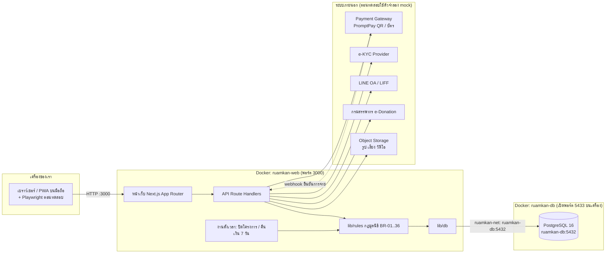

เว็บกับฐานข้อมูลแยกเป็น 2 Docker project ต่อกันผ่าน network `ruamkan-net` เว็บต่อที่ `ruamkan-db:5432` · พอร์ต **5433** เปิดให้เครื่องเราเท่านั้น (ดูข้อมูลตอนทดสอบ)

| ชั้น | อยู่ที่ไหน | หน้าที่ | ทดสอบด้วยอะไร |
|---|---|---|---|
| เบราว์เซอร์/PWA | เครื่องผู้ใช้ | ฟอร์ม ปักหมุด อัดเสียง สแกน QR (FR-09..12, 36, 62) | Playwright (viewport 375px) |
| หน้าเว็บ | ruamkan-web | แสดงโครงการ หลอดความคืบหน้า สถานะ (FR-23..26, 65) | Playwright E2E |
| API | ruamkan-web | รับคำสั่ง ตรวจสิทธิ์ เรียกกฎ ต่อระบบภายนอก (NFR-10) | API test (HTTP) + Playwright |
| lib/rules | ruamkan-web | กฎมูลนิธิ: ยอด เปอร์เซ็นต์ ค่าขอบ BR-01..36 | unit test (ค่าขอบ) |
| งานตั้งเวลา | ruamkan-web | ปิดโครงการ คืนเงิน 7 วัน ปล่อยงานผู้รับรอง (FR-31, 63, BR-15) | unit test + ล็อก "วันนี้" (NFR-18) |
| PostgreSQL | ruamkan-db | เก็บข้อมูล ล็อกยอด กันจองซ้อน (NFR-07, 12) | SQL ตรวจหลังทำรายการ |
| ระบบภายนอก | ผู้ให้บริการ | จ่ายเงิน ยืนยันตัวตน แจ้งเตือน e-Donation | mock ที่ตอบตามสคริปต์ |

ทำที่เบราว์เซอร์: ปักหมุด อัดเสียง/วิดีโอ สแกน QR เช็กอิน · ทำที่เซิร์ฟเวอร์: กฎทุกข้อ คำนวณเงิน ตัดสินผลโครงการ (ห้ามเชื่อค่าจากเบราว์เซอร์)

---

## 2. Use Case

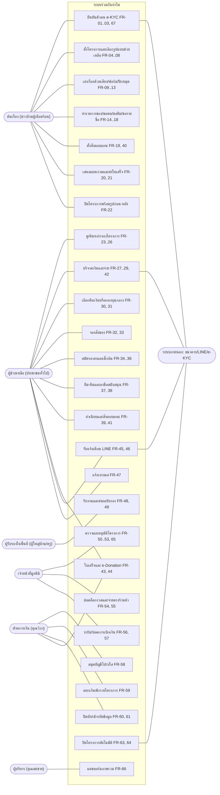

ครบทุกกลุ่มในบันทึกสัมภาษณ์: ต้นเรื่อง · ผู้ช่วยเหลือ · ผู้รับรอง · เจ้าหน้าที่ · ฝ่ายการเงิน · ผู้บริหาร · ระบบภายนอก

---

## 3. Flowchart

### 3.1 ส่งโครงการและตรวจก่อนเปิด

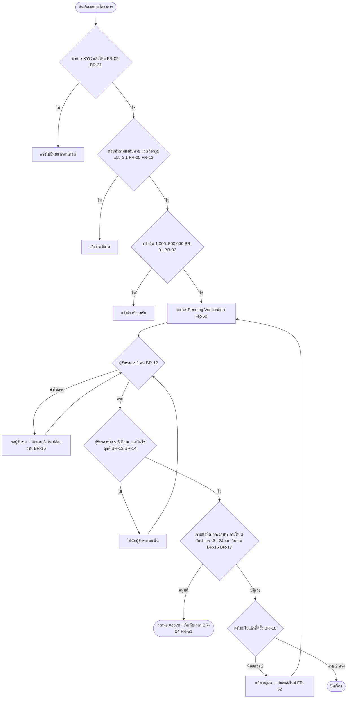

### 3.2 บริจาคเงิน

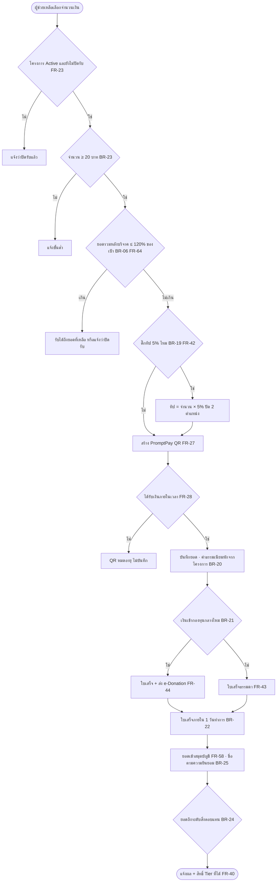

### 3.3 ครบกำหนดและสรุปผลโครงการ

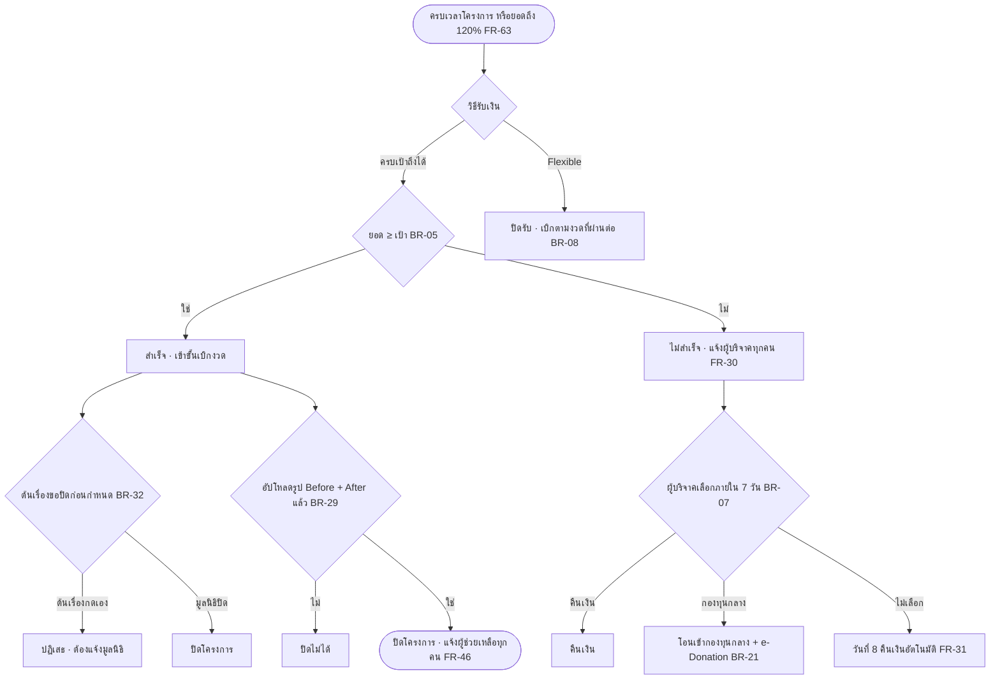

### 3.4 เบิกเงินตามงวด

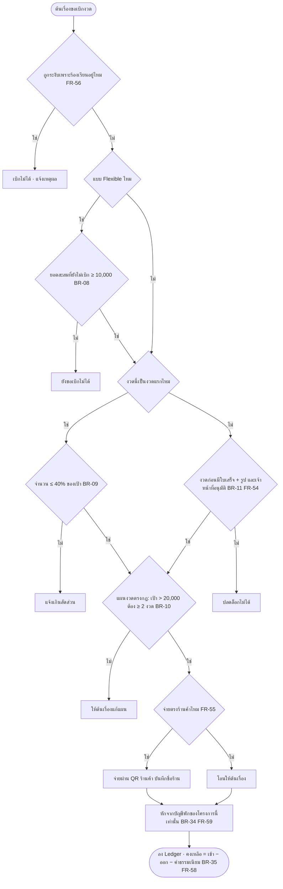

### 3.5 ร้องเรียนและระงับเบิก

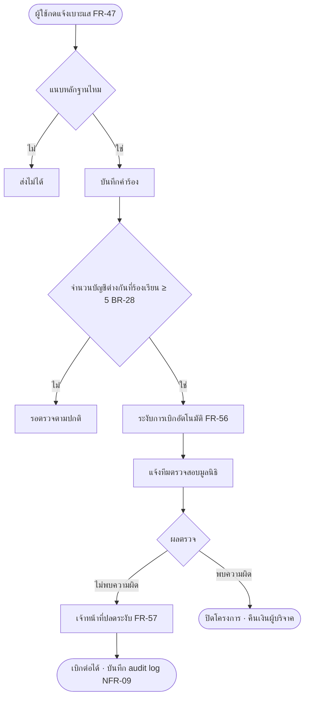

### 3.6 คำนวณยอดสุทธิของรายการบริจาค (ลำดับสำคัญ)

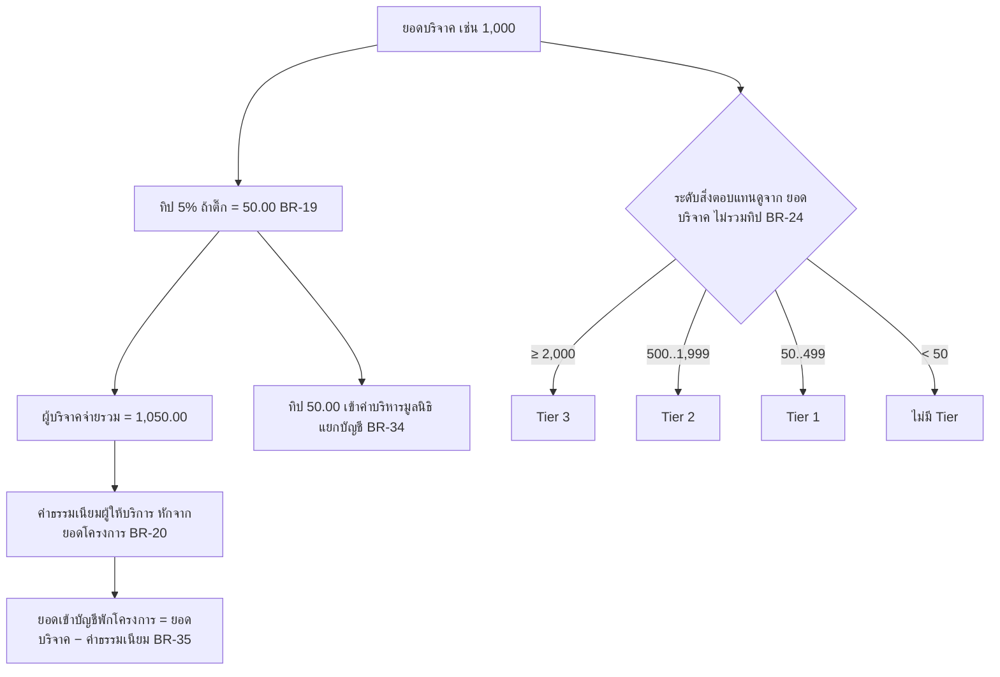

---

## 4. ERD

ชนิดข้อมูล: เงินและยอดเป็น `NUMERIC(12,2)` (ห้าม float) · จำนวนชิ้น/คน/ครั้งเป็น `INTEGER` · เวลาเป็น `TIMESTAMPTZ` · เปอร์เซ็นต์งวดเป็น `NUMERIC(5,2)`

```mermaid
%% name: erd
erDiagram
  users ||--o{ projects : "ตั้ง (ต้นเรื่อง)"
  users ||--o| kyc_records : "ยืนยันตัวตน"
  users ||--o{ donations : "บริจาค"
  users ||--o{ item_pledges : "จองของ"
  users ||--o{ volunteer_signups : "สมัครอาสา"
  users ||--o{ vouchings : "รับรอง"
  users ||--o{ flags : "ร้องเรียน"
  users ||--o{ signatures : "ลงชื่อ"
  projects ||--o{ project_support_types : "รูปแบบที่ขอ"
  projects ||--o{ project_items : "รายการของ"
  projects ||--o{ skill_needs : "ขอคน"
  projects ||--o{ loan_requests : "ขอยืม"
  projects ||--o{ reward_tiers : "สิ่งตอบแทน"
  projects ||--o{ milestones : "งวดเบิก"
  projects ||--o{ vouchings : "ผู้รับรอง"
  projects ||--o{ reviews : "ผลตรวจ"
  projects ||--o{ donations : "รับเงิน"
  projects ||--o{ flags : "ถูกร้องเรียน"
  projects ||--o{ signatures : "รายชื่อ"
  projects ||--|| wallets : "บัญชีพัก"
  project_items ||--o{ item_pledges : "ถูกจอง"
  skill_needs ||--o{ volunteer_signups : "คนมาช่วย"
  volunteer_signups ||--o| checkins : "เช็กอิน"
  loan_requests ||--o{ loans : "สัญญายืม"
  milestones ||--o{ milestone_evidence : "ใบเสร็จ/รูป"
  milestones ||--o{ disbursements : "จ่ายเงิน"
  donations ||--o| receipts : "ใบเสร็จ"
  wallets ||--o{ ledger_entries : "รายการบัญชี"
  donations ||--o{ ledger_entries : "ก่อรายการ"
  disbursements ||--o{ ledger_entries : "ก่อรายการ"
  users {
    uuid id PK
    text email
    text role "starter helper voucher staff finance exec"
    text display_name
    boolean consent_show_name
    text address_enc "เข้ารหัส"
    geography home_point
  }
  kyc_records {
    uuid user_id PK
    text id_card_enc "เข้ารหัส"
    boolean face_verified
    timestamptz verified_at
  }
  projects {
    uuid id PK
    uuid starter_id FK
    text status "pending active suspended closed rejected"
    text funding_mode "all_or_nothing flexible"
    numeric target_amount "NUMERIC(12,2) 1000..500000"
    integer duration_hours "360 720 72"
    timestamptz activated_at
    timestamptz ends_at
    integer resubmit_count "0..2"
    boolean frozen
  }
  project_support_types {
    uuid project_id FK
    text type "money item labor loan advocacy"
  }
  project_items {
    uuid id PK
    uuid project_id FK
    text name
    integer qty_needed
    integer qty_reserved "CHECK reserved <= needed"
  }
  skill_needs {
    uuid id PK
    uuid project_id FK
    text skill
    integer headcount
    timestamptz work_date
  }
  loan_requests {
    uuid id PK
    uuid project_id FK
    text item_name
    integer days
  }
  loans {
    uuid id PK
    uuid loan_request_id FK
    uuid lender_id FK
    text status "active returned overdue"
    date due_date
  }
  reward_tiers {
    uuid id PK
    uuid project_id FK
    numeric min_amount "NUMERIC(12,2)"
    text description
  }
  milestones {
    uuid id PK
    uuid project_id FK
    integer seq
    numeric percent "NUMERIC(5,2)"
    numeric amount "NUMERIC(12,2)"
    text status "locked requested approved paid"
  }
  milestone_evidence {
    uuid id PK
    uuid milestone_id FK
    text kind "receipt photo"
    text file_url
  }
  disbursements {
    uuid id PK
    uuid milestone_id FK
    numeric amount "NUMERIC(12,2)"
    text payee_type "starter merchant"
    text merchant_name
    timestamptz paid_at
  }
  vouchings {
    uuid id PK
    uuid project_id FK
    uuid voucher_id FK
    numeric distance_km "NUMERIC(5,2)"
    text status "taken submitted released"
    timestamptz taken_at
  }
  reviews {
    uuid id PK
    uuid project_id FK
    uuid staff_id FK
    text decision "approve reject"
    text reason
    timestamptz decided_at
  }
  donations {
    uuid id PK
    uuid project_id FK
    uuid donor_id FK
    numeric amount "NUMERIC(12,2) >= 20"
    numeric tip "NUMERIC(12,2)"
    numeric gateway_fee "NUMERIC(12,2)"
    boolean to_central_fund
    text status "pending paid refunded"
    text refund_choice "refund central none"
  }
  receipts {
    uuid id PK
    uuid donation_id FK
    boolean edonation_sent
    timestamptz issued_at
  }
  item_pledges {
    uuid id PK
    uuid item_id FK
    uuid donor_id FK
    integer qty
    text tracking_no
  }
  volunteer_signups {
    uuid id PK
    uuid need_id FK
    uuid user_id FK
  }
  checkins {
    uuid signup_id PK
    timestamptz at
  }
  signatures {
    uuid project_id FK
    uuid user_id FK
  }
  flags {
    uuid id PK
    uuid project_id FK
    uuid reporter_id FK
    text evidence_url
  }
  wallets {
    uuid id PK
    uuid project_id FK
    numeric balance "NUMERIC(12,2) CHECK >= 0"
  }
  ledger_entries {
    uuid id PK
    uuid wallet_id FK
    text kind "in out fee"
    numeric amount "NUMERIC(12,2)"
    timestamptz at
  }
  audit_log {
    uuid id PK
    uuid actor_id FK
    text action "approve release freeze unfreeze"
    uuid project_id FK
    timestamptz at
  }
```

**กลไกในฐานข้อมูลที่รับกฎของร้าน**

| กฎ | กลไก |
|---|---|
| สิ่งของจองเกินที่ขาดไม่ได้ BR-26, NFR-12 | `CHECK (qty_reserved <= qty_needed)` + `UPDATE ... WHERE qty_reserved + :qty <= qty_needed` ใน transaction เดียว |
| 1 บัญชีลงชื่อ 1 ครั้งต่อโครงการ BR-27 | `UNIQUE (project_id, user_id)` ใน `signatures` |
| ยอดบริจาครวมไม่เกิน 120% BR-06 | ล็อกแถว `projects` (`SELECT ... FOR UPDATE`) ตอนบันทึกยอด แล้วเทียบ `SUM(donations.amount)` |
| บัญชีพักไม่ติดลบ BR-34 | `CHECK (balance >= 0)` ใน `wallets` และห้ามจ่ายข้าม `wallet_id` |
| Ledger ห้ามแก้ย้อนหลัง FR-58 NFR-07 | `ledger_entries` เพิ่มอย่างเดียว (ไม่มี UPDATE/DELETE) ยอด `balance` ต้องเท่ากับ `SUM` |
| ส่งใหม่ไม่เกิน 2 ครั้ง BR-18 | `CHECK (resubmit_count BETWEEN 0 AND 2)` |
| งวดแรก ≤ 40% BR-09 | `CHECK` ผ่านฟังก์ชันตรวจตอนเพิ่ม `milestones` (seq = 1) |
| ข้อมูลอ่อนไหวเข้ารหัส NFR-05 | คอลัมน์ `*_enc` ใช้ `pgcrypto` เข้ารหัสก่อนบันทึก |

---

## 5. Sequence

### 5.1 ผู้ช่วยเหลือบริจาคผ่าน PromptPay

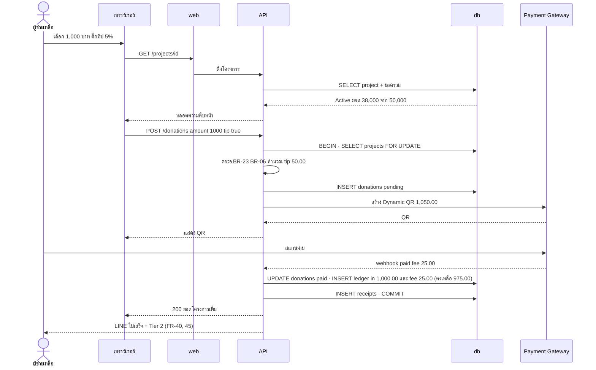

### 5.2 อนุมัติและปลดล็อกงวดเบิกเงิน

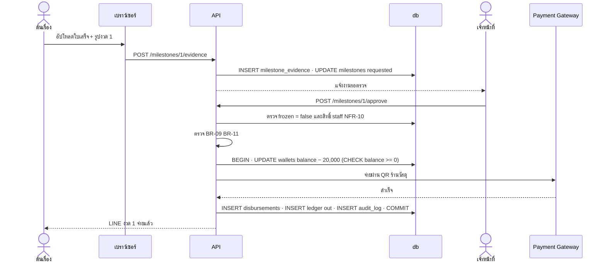

### 5.3 สองคนจองสิ่งของชิ้นสุดท้ายพร้อมกัน

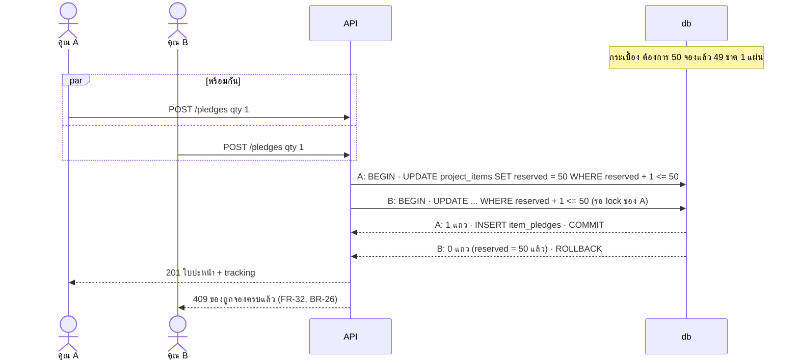

---

## 6. คำถามที่ได้จากการออกแบบ

| รหัส | คำถาม | เกี่ยวกับ |
|---|---|---|
| D-01 | ทิป 5% เข้า "ค่าบริหารมูลนิธิ" บัญชีแยกใช่ไหม และเข้าโครงการหรือไม่ (ตอนนี้ออกแบบแยก) | FR-42, BR-19, FR-59 |
| D-02 | ผู้บริจาคจ่ายแล้วแต่ยอดจะเกิน 120% ตอนจ่าย (QR ที่ออกก่อนหน้า) คืนส่วนเกินหรือรับเต็ม | BR-06, FR-64 |
| D-03 | โครงการ Flexible ครบเวลาแล้วเงินที่ยังไม่เบิก (เหลือสะสมไม่ถึง 10,000) เบิกได้อย่างไร | BR-08 |
| D-04 | ผู้บริจาคที่เลือก "กองทุนกลาง" ได้ e-Donation แต่เงินจากโครงการที่ไม่ถึงเป้าเป็นเงินพักของโครงการ ย้ายบัญชีตอนไหน | BR-07, BR-21 |
| D-05 | งวดที่ถูกระงับ (ร้องเรียน) เวลาของโครงการเดินต่อไหม โดยเฉพาะเคส 72 ชม. | BR-04, BR-28 |
| D-06 | ผู้รับรองต้องผ่านการยืนยันตัวตนไหม และถ้าผู้รับรองคนที่ 2 ถูกถอนทีหลังอนุมัติ โครงการยังเปิดได้ไหม | BR-12 |
| D-07 | ผู้ช่วยเหลือบริจาคแบบไม่ล็อกอินได้ไหม (ผลต่อใบเสร็จและ e-Donation ที่ต้องมีชื่อ/เลขภาษี) | FR-43, FR-44 |
| D-08 | ผู้บริจาคเปลี่ยนใจขอคืนเงินก่อนโครงการจบได้ไหม | FR-30 |
| D-09 | สิ่งของที่จองแล้วไม่ส่งภายในกี่วัน ระบบปล่อยโควตาคืน | BR-26, FR-32 |
| D-10 | จุดไหนที่มูลนิธิใช้ "ผลตรวจ" ย้อนกลับ Active เป็น Suspended นอกจากร้องเรียน | FR-56 |
| D-11 | ราคาค่าธรรมเนียม PSP ต่างกันตามวิธีจ่าย (QR / บัตร) แสดงตามจริงทุกรายการใช่ไหม | BR-20, FR-58 |
| D-12 | ข้อมูลผู้รับรองและใบเสร็จของต้นเรื่องเก็บนานแค่ไหน ตาม PDPA | FR-61, NFR-05 |

**สมมติฐานในการออกแบบ**

| รหัส | สมมติฐาน |
|---|---|
| DA-01 | ทิป 5% แยกเข้าบัญชีค่าบริหาร ไม่นับเป็นยอดโครงการ และไม่นับระดับ Tier (ดู D-01) |
| DA-02 | ระดับสิ่งตอบแทนคิดจากยอดบริจาคไม่รวมทิป |
| DA-03 | ยอดที่จะเกิน 120% ระบบรับเท่าที่เหลือแล้วคืนส่วนที่เกิน |
| DA-04 | ใช้ตัวจำลอง (mock) ของ Payment Gateway, e-KYC, LINE, e-Donation ตอนทดสอบ |
| DA-05 | การปิดโครงการและคืนเงินใช้งานตั้งเวลาในเว็บเอง ไม่ใช้ตัวจัดคิวภายนอกในเฟสแรก |

---

## 7. สรุปแผนภาพและความครอบคลุม

| แผนภาพ | จำนวน | ไฟล์ภาพ |
|---|---|---|
| System Architecture | 1 | `design/architecture.png` |
| Use Case | 1 | `design/use-case.png` |
| Flowchart | 6 | `design/flow-verify.png` `flow-donate.png` `flow-close.png` `flow-disburse.png` `flow-flag.png` `flow-price.png` |
| ERD | 1 (24 ตาราง) | `design/erd.png` |
| Sequence | 3 | `design/seq-donate.png` `seq-disburse.png` `seq-race.png` |
| **รวม** | **12** | render ผ่านด้วย mermaid-cli 12/12 |

| ข้อกำหนด | ทั้งหมด | อยู่ในแผนภาพ | ยังไม่อยู่ในแผนภาพใดเลย |
|---|---|---|---|
| FR | 67 | 67 | ไม่มี |
| BR | 36 | 36 | ไม่มี |
| NFR | 19 | 6 | NFR-01, 02, 03, 04, 06, 08, 11, 13, 14, 15, 16, 17, 19 (เป็นคุณสมบัติรวม วัดตอนทดสอบ ไม่ใช่ขั้นตอนในแผนภาพ) |

ตรวจด้วยสคริปต์ที่อ่านรหัส `FR-xx` `BR-xx` `NFR-xx` จาก DESIGN.md เทียบกับตารางใน REQUIREMENTS.md
